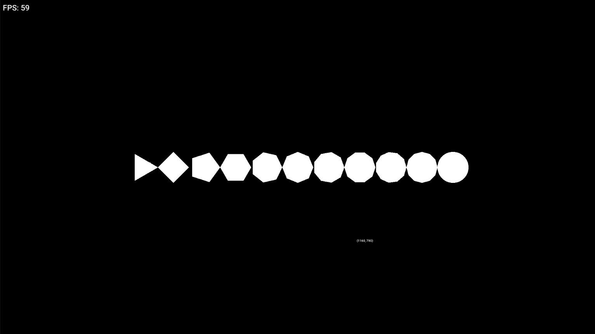
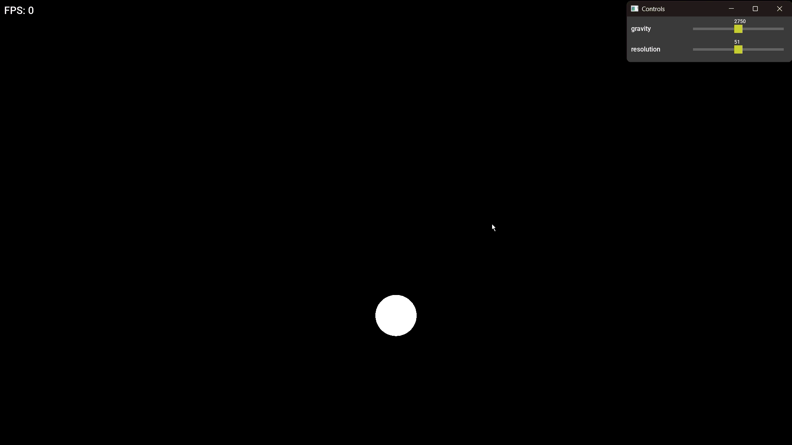
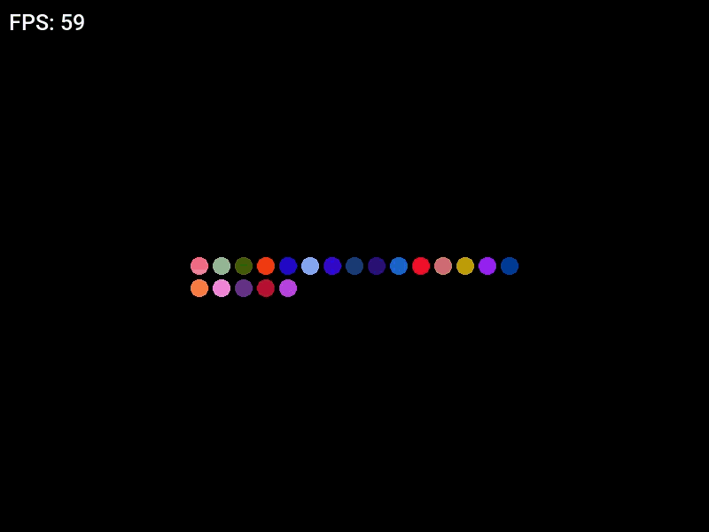
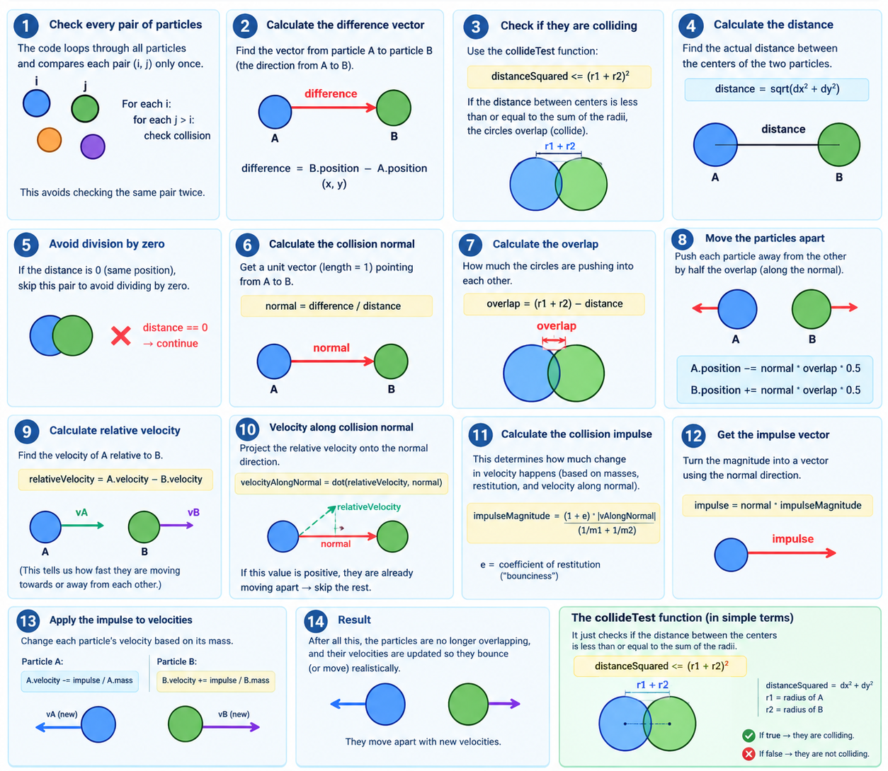
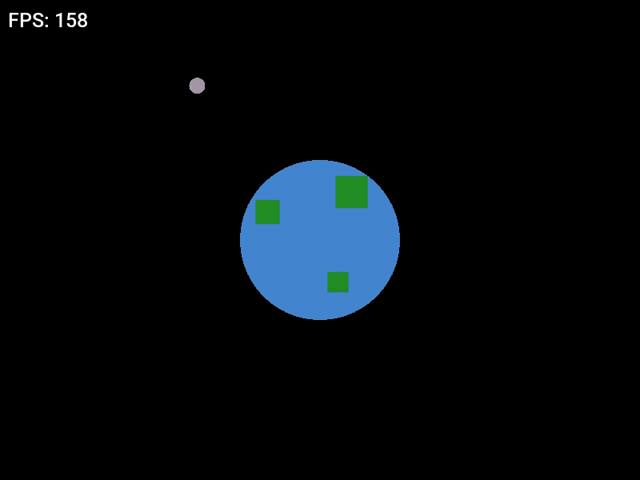
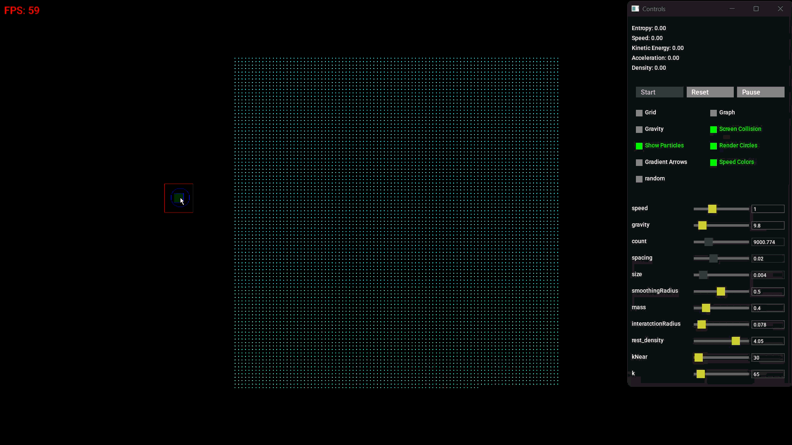

# Simple Pyshics Enginee

A small C++ physics sandbox built with C++ and SDL3.

## Setup and Run

1. Install MinGW with `g++` and make sure it is available in your PATH.
2. Download and install the SDL3 development library and the SDL3_ttf development library:
	- [SDL3](https://github.com/libsdl-org/SDL/releases)
	- [SDL3_ttf](https://github.com/libsdl-org/SDL_ttf/releases)
3. Clone the repository:

```bash
git clone https://github.com/Ayham-Ahmad/TryPhysicsEngine.git
cd TryPhysicsEngine
```

4. Update the SDL paths in `build.bat` if they are different on your computer.
5. Build the project:

```bash
build.bat
```

6. Run the application:

```bash
main.exe
```

## First Step

The first thing we did is to create a circle using triangles, so we use SDL_RenderGeometry() for it.



## Second Step: Gravity

The second step adds gravity so particles accelerate and fall over time.



## Third Step: Collision

The third step adds collisions between particles and the screen boundaries. The current step can run up to only a *1,000* particles at 60 FPS.

This step collision method checks every particle against every other particle to find collisions. It also checks every particle against the screen boundaries on each update.



And this is the third step collision equations:



## Fourth Step: Gravitational Force

In this step, gravitational force was added to simulate the orbit of the Moon around the Earth.

The gravitational acceleration acting on object **A** due to object **B** is calculated using Newton's law of universal gravitation:

$$
a = \frac{Gm_b}{r^2}
$$

Where:

* \(a\) = gravitational acceleration acting on object A
* \(G\) = gravitational constant used in the simulation
* \(m_b\) = mass of object B
* \(r\) = distance between the two objects

```cpp
float acc = (Globals::gravity * b.rigidBody.mass) / (distance * distance);
```

The acceleration is then applied in the direction of object B, causing the Moon to orbit the Earth.



## Fifth Step: Spatial Hash

Checking every particle against every other particle does not scale, so before the fluid is computed the particles are sorted into a grid. The cell size is the interaction radius, so a particle only has to look at its own cell and the 8 cells around it to find every neighbour that can affect it.

Each cell is stored in a hash map, so the grid does not have to be allocated for the whole world, and the set of neighbouring particles is found in a few steps instead of a full scan.

```cpp
uint32_t hash = (cellX * prime1 ^ cellY * prime2) % hashMapSize;
```



## Sixth Step: Double Density Relaxation

The last step makes the particles behave like a fluid. It uses the double density relaxation method from Clavet et al. 2005, where every particle looks at the neighbours found by the hash and measures two densities, with `q` being the distance to the neighbour divided by the interaction radius `h`:

* `density = Σ(1 - q)²`
* `densityNear = Σ(1 - q)³`

The two densities are turned into pressures:

```cpp
float pressure = Globals::k * (density - Globals::targetDensity);
float pressureNear = Globals::kNear * densityNear;
```

and then every pair of particles is pushed apart by:

```cpp
float displacementTerm = dt * dt * (pressure * (1 - q) + pressureNear * (1 - q) * (1 - q));
```

`targetDensity` is the density the fluid relaxes towards: above it the fluid contracts, below it the fluid expands. `k` controls how stiff the fluid is and `kNear` keeps the closest particles from collapsing into each other.


## Libraries

- [SDL3](https://github.com/libsdl-org/SDL): window creation, rendering, input, and geometry drawing.
- [SDL3_ttf](https://github.com/libsdl-org/SDL_ttf): TrueType font support for on-screen text.
